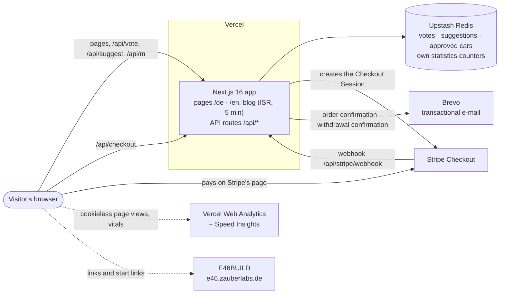

# zauberlabs.de

> **Independent configurators for modern classics. Made by owners, for owners.**

zauberlabs.de is the hub for zauberlabs' car configurators. It is **live at <https://www.zauberlabs.de>** in German
(`/de`, the default) and English (`/en`).

- **Configurators.** The first one is **E46BUILD** for the BMW 3 Series E46, which runs separately at
  <https://e46.zauberlabs.de>. The home page leads into it: the hero, body-style buttons and the "Take a closer look"
  panel link straight into E46BUILD, optionally with a body (`?start=`) or a section (`?section=`) already chosen.
- **Blog.** Researched E46 articles in German and English (MDX), published one at a time on a schedule.
- **Community vote.** Visitors vote for the car that should get the next configurator, and can suggest a car.
- **Fan shop.** Die-cut E46 stickers, paid through Stripe Checkout, with our own order confirmation e-mail and an
  online withdrawal function.

How the team of agents works on this repository: [`docs/HOW-WE-WORK.md`](docs/HOW-WE-WORK.md).

---

## Architecture



Only these outside services are used; each is wired up in the code named below:
- **Upstash Redis:** `lib/store.ts`, `lib/metrics-store.ts`.
- **Stripe:** `app/api/checkout`, `app/api/stripe/webhook`, `lib/shop-checkout.ts`.
- **Brevo:** `lib/brevo.ts`.
- **Vercel Web Analytics and Speed Insights:** `components/SiteAnalytics.tsx`.

Orders live in Stripe; this app stores none.

## Stack

| | |
| --- | --- |
| Framework | Next.js `^16.3.6` (App Router), React `^19.3.0`, TypeScript `^5.9` |
| Styling | Tailwind CSS `^4.3.3` (+ `@tailwindcss/typography` for articles) |
| Content | MDX via `next-mdx-remote` `^6`, `gray-matter`, `remark-gfm`, `rehype-slug`; front matter checked with `zod` `^4` |
| Data | `@upstash/redis` `^1.39` |
| Payments | `stripe` `23.0.0` (pinned) |
| Analytics | `@vercel/analytics` `^2.0.1`, `@vercel/speed-insights` `2.0.0` (pinned) |
| Tests | `node:test` run through `tsx` |
| Hosting | Vercel |

Note: install with `npm ci --legacy-peer-deps` (a plain `npm install` hits an npm peer-dependency bug in this tree).

## Repository layout

```
app/
  [lang]/                 pages per language: home, blog (+ tag pages, sources, feed.xml), shop (+ success/cancel),
                          agb, widerrufsbelehrung, versand-zahlung, vertrag-widerrufen, impressum, datenschutz, admin
  api/                    vote, suggest, m (own statistics beacon), internal-mode, admin (+ stats),
                          checkout, stripe/webhook, withdrawal
  icon.svg, favicon.ico, apple-icon.png, sitemap.ts, robots.ts
components/               page sections (HomeHero, CloserLook, VoteCard, SuggestForm, SiteFooter …),
  blog/                   article components (MDX map, figures, sources, configurator CTA, read beacon)
  shop/                   shop UI (ShopClient, legal blocks, withdrawal form)
content/blog/<slug>/      one folder per article: en.mdx, de.mdx, images — see content/blog/README.md
lib/                      i18n copy, blog loader + schema, shop catalogue/pricing/checkout, legal texts (lib/legal),
                          order and withdrawal e-mails, Redis store, statistics, internal mode
public/                   images (origins in public/images/README.md), shop pictures, e-mail logo
scripts/                  smoke test, production-check tool, image/favicon generators
tests/                    node:test suites (*.test.mts)
docs/                     how the team works
```

## Key flows

**Blog.** Articles are MDX files in `content/blog/<slug>/{de,en}.mdx`, with front matter described in
`content/blog/README.md`. An article with `publishAt: "YYYY-MM-DD"` goes live at **07:00 Europe/Berlin** that day and
stays hidden before that (`lib/publish-time.ts`). The blog pages re-render at most every 5 minutes (ISR,
`revalidate = 300`), so no deploy is needed at publish time. `draft: true` hides an article on production only.

**Shop.**
1. The cart is kept in the browser's `localStorage` (`zl_shop_cart`, `zl_shop_country`).
2. "Continue to payment" posts the product ids, quantities, language and delivery country to `/api/checkout`.
   That route prices everything server-side (`lib/shop-pricing.ts`, `lib/shop-products.ts`) and creates a Stripe
   Checkout Session.
3. The buyer pays on Stripe's page.
4. Stripe calls `/api/stripe/webhook`. The route checks the signature, reads the paid session and sends our order
   confirmation through Brevo (bcc to us).
5. It marks the PaymentIntent (`metadata.zl_confirmation_sent`), so the mail goes out once.

`SHOP_LAUNCHED` controls everything that changes at launch: the public shop pages, indexing, the sitemap, the footer
and header links, the legal texts in the Datenschutz/Impressum, and whether live Stripe keys are accepted. While it is
off, the shop is visible only to internal devices and on local and preview builds.

**Withdrawal (§ 356a BGB).** `/[lang]/vertrag-widerrufen` posts to `/api/withdrawal`, which immediately e-mails the
confirmation of receipt (the content of the declaration, plus the date and time) to the customer, with a copy to us.
Nothing is stored on our server.

**Votes and suggestions.**
- `/api/vote` handles one vote per car per visitor (cookie `zl_vid`, rate-limited).
- `/api/suggest` stores car suggestions.
- Suggestions are reviewed on `/de/admin` (password-protected); approved cars join the vote.

**Own statistics.** Article pages send an anonymous beacon to `/api/m`, which keeps daily counters in Redis (no cookies,
no IP stored; production `m:*`, preview/local `m:test:*`). The counters show up under "Reading statistics" on
`/de/admin`. Devices carrying the internal marker cookie `zl_internal=1` are counted neither here nor in Vercel
Analytics. The marker is set once per device via `/api/internal-mode`.

## Environment variables

Names only; the values live in Vercel.

| Group | Variables |
| --- | --- |
| Redis | `KV_REST_API_URL`, `KV_REST_API_TOKEN` (from Vercel's Upstash integration) or `UPSTASH_REDIS_REST_URL`, `UPSTASH_REDIS_REST_TOKEN` |
| Votes / admin | `VOTE_SALT`, `ADMIN_PASSWORD` |
| Statistics | `STATS_MONTHLY_COMMAND_BUDGET` (optional), `ZL_INTERNAL_SECRET` (gates `/api/internal-mode`) |
| Shop | `SHOP_LAUNCHED` (`1` = launched), `STRIPE_SECRET_KEY`, `STRIPE_WEBHOOK_SECRET` |
| E-mail | `BREVO_API_KEY`, `SHOP_MAIL_FROM` (optional sender, must be verified in Brevo), `BREVO_API_URL` (local tests only) |
| E46BUILD links | `NEXT_PUBLIC_E46_LIVE` (`1` = links are live), `NEXT_PUBLIC_E46_URL` (optional, default `https://e46.zauberlabs.de`) |
| Set by Vercel | `VERCEL_ENV` |
| Smoke test | `SMOKE_PORT`, `SMOKE_SKIP_BUILD` |

Without Redis credentials, votes and suggestions fall back to an in-memory store for local development only. On
production that is refused.

## Run, test, deploy

```bash
npm ci --legacy-peer-deps
npm run dev          # http://localhost:3000 → redirects to /de

npm run typecheck    # tsc --noEmit
npm test             # node:test suites in tests/
npm run smoke        # production build, start on a free port (default 3010), request every blog route
npm run check        # all three
```

**Deploy:** a push or merge to `main` deploys to production on Vercel automatically; every other branch gets a preview
deployment.

**Checking production in a browser:** use `node scripts/prod-check.mjs [-v WxH]... [--full] URL...` only. It sets the
internal-mode cookie before the first page loads, keeps the headless User-Agent, and stops if any analytics or
statistics request leaves the page. So checks are never counted. For "is it live" checks, plain `curl` is enough.
